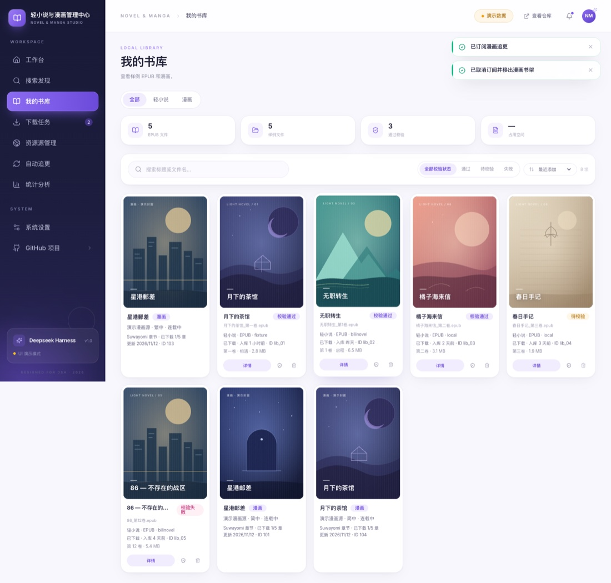

# 轻小说与漫画书库 · Novel & Manga Library

**在一个 Web 管理台里搜索、下载和管理轻小说与漫画。** 轻小说由原有 Dart 引擎生成 EPUB，漫画由 Suwayomi 下载。可以把漫画按卷归档成 CBZ，存入 Komga 的书库目录，也可以让 DeepSeek Harness（DSH）调用原生工具管理下载和查询进度。

适合部署在飞牛 NAS 或其他 Linux x86-64 Docker 主机。使用 Web 管理台无需安装 DSH 或配置大模型。



[部署到 NAS](docs/DEPLOY-NAS.md#4-web-管理台bff--live-前端) · [WebUI 使用指南](web/README.md) · [连接 Suwayomi](docs/MANGA.md) · [连接 Komga](docs/KOMGA.md) · [安装 DSH 插件](docs/DSH-MANGA.md)

## 你可以做什么

| 场景 | 能力 |
| --- | --- |
| **轻小说** | 搜索、查看详情和目录，选卷下载 EPUB。支持合卷、查询任务、取消与重试，以及书库文件校验。 |
| **漫画** | 搜索 Suwayomi 已安装的来源，查看章节、已读和已下载状态，批量加入下载队列。简繁和别名用于扩展检索词，同名作品保留各自的来源。 |
| **按卷归档** | 选卷后「一键下载到 Komga」。归档容器读取实际下载进度，齐卷后生成 CBZ。轻小说 EPUB 与漫画 CBZ 可分别浏览 NAS 目录，也可使用 Komga 书库路径并发起扫描。 |
| **统一书库** | 在同一界面浏览 EPUB、Suwayomi 书架和已连接的 Komga 书库。Komga 负责扫描、阅读和阅读记录。 |
| **账号与 API** | Docker 版首次创建管理员，登录可选择在此设备保留 8 小时、1 天、7 天或 30 天。系统设置可填写 Komga API Key，也可生成或撤销 DSH 只读密钥。 |

Studio、Suwayomi、CBZ 归档容器可以独立部署。Studio 负责界面与 API，Dart 和 Suwayomi 分别处理各自的下载；归档容器读取 Suwayomi 的已下载文件，两个引擎各自保留数据。

## 快速开始

### 先看界面

需要 Node.js 24.9 或更新版本。下面启动默认 Mock 模式，使用明确标注的演示数据。

```sh
git clone https://github.com/xieqiong111/dsh-plugin-lightnovel.git
cd dsh-plugin-lightnovel
git switch feat/suwayomi-manga-studio
npm --prefix web ci
npm --prefix web run dev -- --host 127.0.0.1
```

打开终端显示的本地预览地址，一般为 `http://127.0.0.1:5173/`。Studio 集成版本目前在 `feat/suwayomi-manga-studio` 分支。

### 部署真实服务

1. 准备 Live 前端、Dart 下载器、持久化目录和 Docker 网络，再启动 Studio。见 [NAS 部署指南](docs/DEPLOY-NAS.md#4-web-管理台bff--live-前端)。
2. 打开 Studio，默认端口为 `5273`。首次部署从持久化数据目录读取初始化码并创建账号。见 [首次登录](web/README.md#首次创建管理员)。
3. 漫画功能需要可访问的 Suwayomi 服务和已安装的来源。可以连接已有实例，也可以用 Compose 启动独立实例。见 [漫画部署和 API](docs/MANGA.md)。
4. 要生成分卷 CBZ，启动归档容器，并将输出目录设为 Komga 漫画库下的目录。要在 Studio 浏览 Komga 书库，在系统设置另行保存 Komga API Key。见 [CBZ 归档](docs/MANGA-VOLUME-CBZ.md)和 [Komga 配置](docs/KOMGA.md)。

### 在 DSH 中使用

使用 **DSH 0.2.2-rc.1**。从功能分支构建后用 `npm pack` 生成插件包，再用 `dsh plugin --profile <名称> add <包路径>` 安装。

- 轻小说从 `novel_search`、`novel_volumes` 开始，用 `novel_download` 创建任务、`novel_tasks` 查询状态。
- 漫画从 `manga_search` 和 `manga_chapters` 开始，用 `manga_download` 下载指定章节。按卷归档使用 `manga_komga_download`，用 `manga_komga_status` 查询进度和实际写入的文件。
- `komga_bangumi_metadata` 搜索 Bangumi 小说和漫画元数据，预览后写入指定的 Komga 系列或单册。[部署与用法](docs/BANGUMIKOMGA.md)
- `studio_read` 使用 WebUI 生成的只读密钥查询 Studio 书库、队列和归档状态。下载工具使用各自后端连接。

[DSH 安装、环境变量与工具列表](docs/DSH-MANGA.md)

## 使用限制

- 筛选漫画语言和来源取决于 Suwayomi 已安装的扩展及源站可用性。
- 自动分卷依赖来源提供卷号。只有话号的内容仍可由 Suwayomi 下载；有卷号的分话会等目录中该卷的所有分话下载齐后再生成 CBZ。Komga 扫描文件后才会显示新书。
- 漫画追更沿用 Suwayomi 的书架和更新策略。轻小说自动追更页面仍是占位。
- Live 模式显示实际服务状态。来源断线或下载失败时，界面显示错误和已确认的进度。在线轻小说书源的搜索条件见 [在线书源说明](docs/LIVE-SOURCES.md)。

## 代码与文档

| 路径 | 用途 |
| --- | --- |
| [`web/`](web/) · [`server/`](server/) | React 管理台、登录、HTTP API 与上游适配 |
| [`src/`](src/) · [`vendor/bili_novel_packer/`](vendor/bili_novel_packer/) | DSH 工具、小说任务与书库，以及原 Dart 核心 |
| [`docker/`](docker/) · [`docs/`](docs/README.md) | 部署配置、CBZ 归档容器与文档索引 |
| [`test/`](test/) · [`scripts/`](scripts/) | 单元测试、离线样例及部署和 API 验证脚本 |

[本地开发与测试](docs/README.md#开发和验证) · [手机端漫画详情截图](docs/images/studio-manga-mobile.jpg)

插件采用 MIT 许可，小说下载基于 [bili_novel_packer](https://github.com/montaro2017/bili_novel_packer)。第三方许可见 [THIRD_PARTY_NOTICES.md](THIRD_PARTY_NOTICES.md)。
