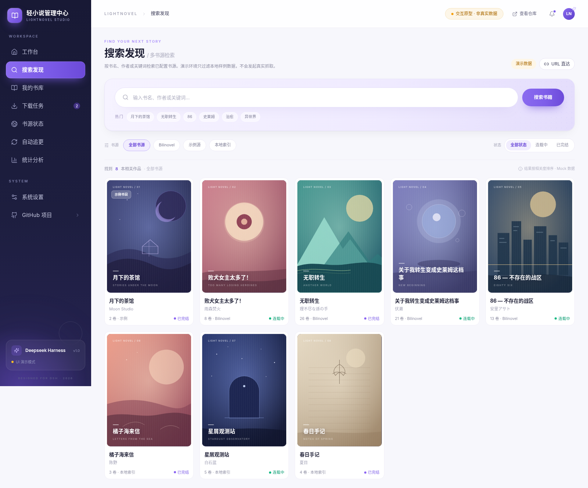
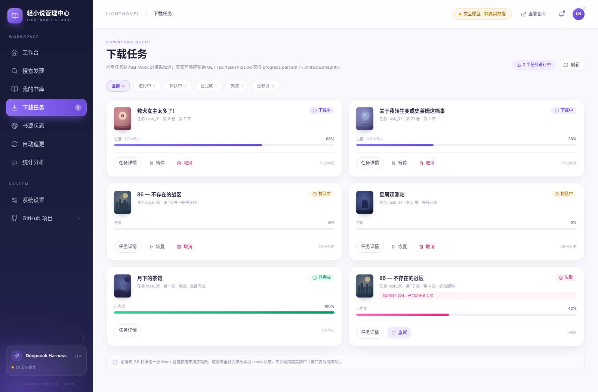
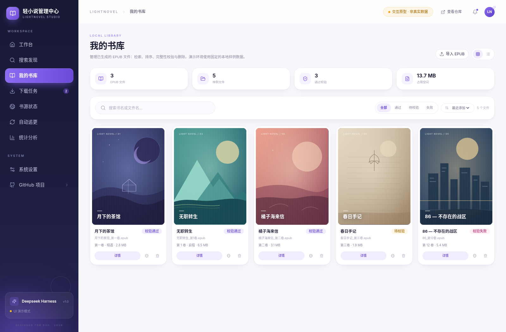
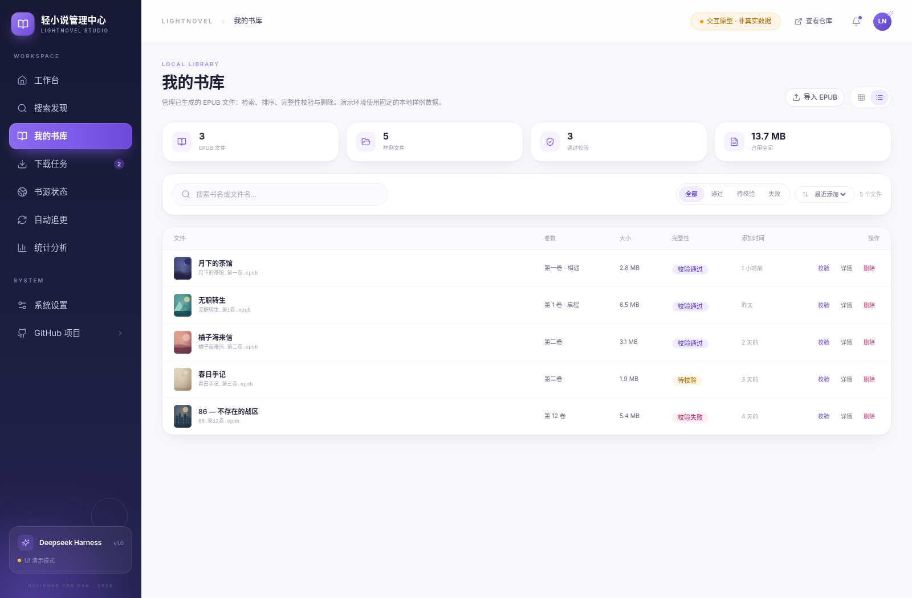
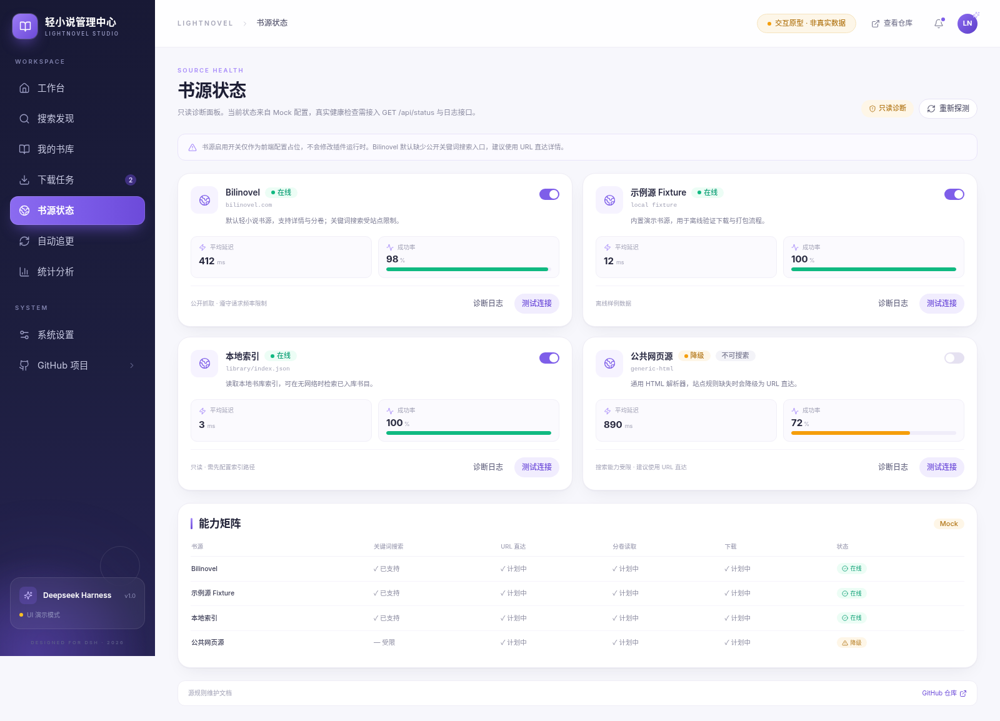
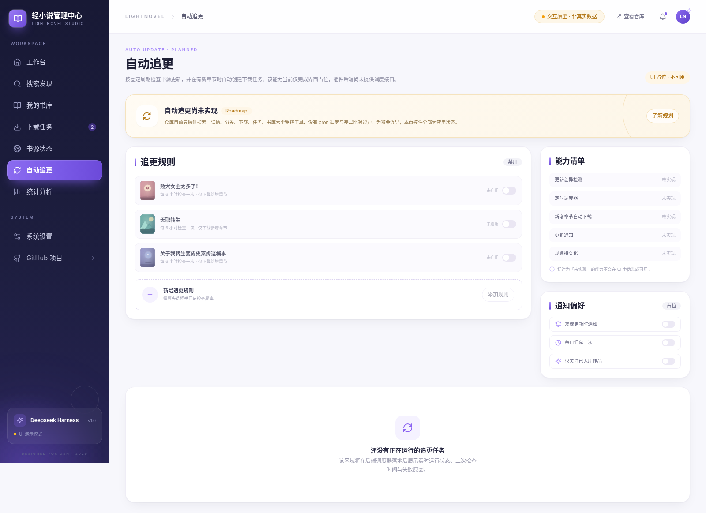
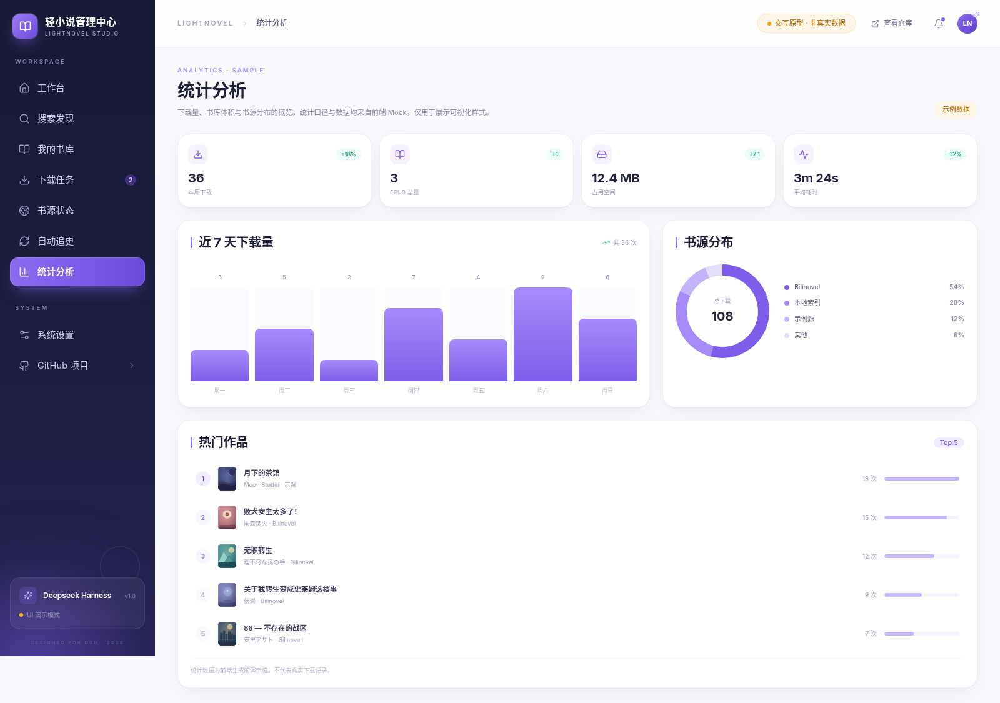
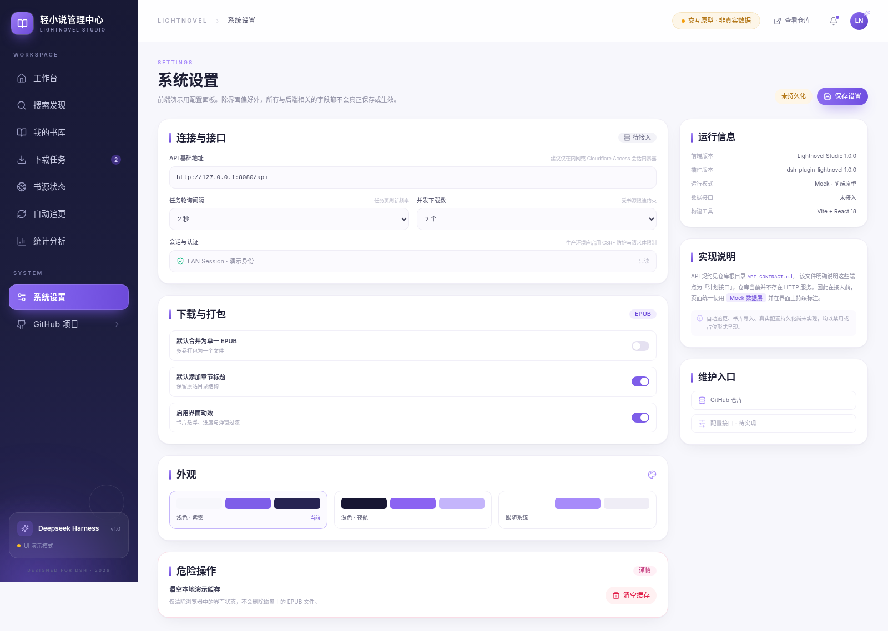
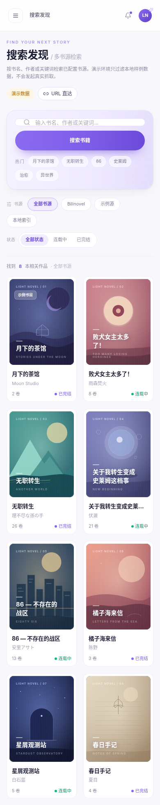

# Novel & Manga Studio · Web 前端

轻小说与漫画统一管理前端。轻小说由原插件和 Dart 生成 EPUB，漫画由独立部署的 Suwayomi 管理。前端复用现有 React 和 Tailwind 视觉组件。

- 技术栈：React 18 · TypeScript 5 · Vite 6 · Tailwind CSS 3 · Lucide Icons · React Router 6
- 数据层：同一个 UI 两种构建模式
  - **Mock（默认）**：`web/src/data/mock.ts` 与 `web/src/data/mangaMock.ts`，静态样例，界面标注「演示数据」
  - **Live**：`VITE_API_MODE=live`，全部调用仓库根 `server/serve.mjs` 的 `/api/*`，由 `PluginRuntime` 或 Suwayomi 驱动，各自保留书库和任务存储
- 漫画接口、部署和验证见 [漫画集成说明](../docs/MANGA.md)。

---

## 1. 快速开始

环境要求：Node.js ≥ 24（BFF 与插件运行时要求，前端本身 ≥ 18）、npm ≥ 9；Live 下载还需 Dart SDK ≥ 3.11 或预编译的 `bnp_headless`。

```bash
cd web
npm install

# A. Mock 预览（无后端）
npm run dev        # http://localhost:5173

# B. Live 开发（另开终端，在仓库根启动 BFF）
node server/serve.mjs          # http://127.0.0.1:5273，/api/* + 静态托管
VITE_API_MODE=live npm run dev # 5173，/api 代理到 5273
```

生产构建与本地预览：

```bash
npm run build                        # Mock：tsc -b && vite build，产物 dist/
VITE_API_MODE=live npm run build     # Live：同一产物目录，调用 /api
npm run preview                      # 默认 http://localhost:4173（需配合 BFF）
npm run typecheck                    # 仅类型检查
```

> 前端使用 `HashRouter`，`dist/` 可直接放到任意静态目录（含子路径）下打开，无需额外 rewrite 规则。`vite.config.ts` 中 `base: './'`；`server.proxy` 仅在 `npm run dev` 生效，生产由 `server/serve.mjs` 同源托管。
>
> `API_BASE` 默认 `/api`，可用 `VITE_API_BASE` 指向独立域名；跨域时在 BFF 侧设 `LN_BFF_CORS_ORIGIN`。

---

## 2. 漫画操作

- 搜索发现、我的书库、下载任务使用同一套「全部 / 轻小说 / 漫画」筛选，类型写入 Hash 路由的 `?type=`。搜索关键词写入 `?q=`。
- 漫画结果按漫画源和资源 ID 保留版本。漫画详情 `/manga/:id` 支持章节更新、批量入队和书架成员操作。Suwayomi 以书架为追更范围，更新周期由 Suwayomi 配置。
- 下载任务显示当前 Suwayomi 队列的真实状态和进度。漫画任务结束离开队列后，在详情页查看章节下载状态。漫画队列控制在 WebUI 中为禁用状态。
- 资源源管理和系统设置提供漫画连接、认证、GraphQL、漫画源、章节读取检查。Live 模式下，漫画错误直接显示，轻小说页面可继续工作。
- 统计分析当前显示轻小说数据。书库仍支持原有 EPUB 完整性校验、下载和删除。

浏览器回归测试使用本机 Chrome 或 `CHROME_BIN` 指定的 Chromium。一个终端执行 `npm run build && npm run preview -- --host 127.0.0.1`，另一终端执行 `npm run verify:manga`。可用 `MANGA_WEB_URL` 指定端口，用 `MANGA_SCREENSHOTS_DIR` 导出截图。

## 3. 原版页面与视觉参考

以下原版设计资料和截图用于复核轻小说布局；漫画入口和当前行为以本页上方说明及漫画集成文档为准。

### 目录结构（原版）

```text
web/
├── public/
│   ├── favicon.svg
│   └── fonts/InterVariable.woff2      # 本地字体，离线可用
├── docs/
│   ├── screenshots/                   # 桌面 / 移动端截图、参考图对比图
│   └── COMPARISON.md                  # 逐区域还原说明
├── src/
│   ├── components/
│   │   ├── common/    ui.tsx（Button/Card/Badge/Progress…）、Modal、Toast、PageHeader
│   │   ├── layout/    AppShell、Sidebar、Topbar
│   │   ├── novel/     CoverArt、HeroArt、NovelCard、NovelDetailDialog、VolumeSelector
│   │   └── tasks/     （任务相关视图内聚在 TasksPage 中）
│   ├── pages/         Dashboard / Search / NovelDetail / Tasks / Library / Sources / AutoUpdate / Stats / Settings
│   ├── data/mock.ts   全部演示数据（小说、分卷、任务、书库、书源、活动）
│   ├── hooks/useAsync.ts
│   ├── services/
│   │   ├── runtime.ts     API_MODE / IS_LIVE / API_BASE / token 与 fetch 封装
│   │   ├── novelApi.ts    mockApi + liveApi 双实现，页面只依赖统一接口
│   │   ├── taskStore.ts   mockStore（2.6s 演示）/ liveStore（2s 轮询 /api/tasks）
│   │   └── utils.ts       cn / sleep / uid / formatBytes
│   ├── styles/index.css   设计变量、卡片、滚动条、骨架屏、动效
│   ├── types/index.ts     领域类型
│   ├── App.tsx
│   └── main.tsx
├── index.html
├── tailwind.config.js
├── postcss.config.js
├── tsconfig.json
├── vite.config.ts
└── package.json
```

---

## 3. 设计变量（从参考图取样）

| 项目 | 取值 | 说明 |
| --- | --- | --- |
| 侧边栏宽度 | `248px` | 固定，深紫渐变 `#181935 → #262352` |
| 顶栏高度 | `76px` | sticky，白 82% + `backdrop-blur` |
| 内容左右留白 | `36px` | 主区最大宽度 `1600px` 居中 |
| 左栏 / 右栏 | `944px / 310px` | `xl` 起两栏，间距 `24px` |
| 主色 | `#7E5EE9`（深 `#6C4AD9`，浅 `#EDE9FE`） | 按钮、选中态、强调线 |
| 页面底色 | `#F7F7FC` | 卡片 `#FFFFFF`，描边 `#F1EFF8` |
| 文字 | `#25263C / #6B6B85 / #A2A2B6` | 三级层级 |
| 圆角 | 卡片 `20px`，内块 `12–14px`，按钮 `10–12px` | — |
| 阴影 | `0 18px 40px -28px rgba(78,54,168,.28)` | 柔和、低透明度 |
| 封面比例 | `3 / 4`（SVG `preserveAspectRatio=slice`） | 任意尺寸不拉伸 |
| 字体 | Inter（数字/拉丁）+ 系统中文字体 | `font-feature-settings:"cv02"` |

语义色：连载 `#10B981`、完结 `#8B63F2`、警告 `#F59E0B`、失败 `#F472B6`。

---

## 4. 界面截图

### 4.1 Dashboard（1600 宽，与参考图同基准）


### 4.2 与参考图并排对比（左侧参考 / 右侧实现，等比 50%）


### 4.3 1440×900 与 1920×1080 桌面端

| 1440×900 | 1920×1080 |
| --- | --- |
|  |  |

### 4.4 其余页面（1600 宽）

| 搜索发现 | 小说详情 |
| --- | --- |
|  |  |

| 下载任务 | 我的书库（网格） |
| --- | --- |
|  |  |

| 我的书库（表格） | 书源状态 |
| --- | --- |
|  |  |

| 自动追更（UI 占位） | 统计分析 |
| --- | --- |
|  |  |



### 4.5 移动端与平板

| 移动端 Dashboard（390） | 移动端搜索 | 移动端任务 |
| --- | --- | --- |
|  |  |  |

| 移动端抽屉导航 | 平板 768 |
| --- | --- |
|  |  |

---

## 5. 与参考图的还原说明（摘要）

完整逐项说明见 [docs/COMPARISON.md](./docs/COMPARISON.md)。

1. **整体骨架**：248px 深紫侧栏 + 76px 毛玻璃顶栏 + 36px 内边距，顶栏左为 `LIGHTNOVEL > 页面名` 面包屑，右为数据模式胶囊（Mock「交互原型 · 非真实数据」/ Live「实时数据」）、查看仓库、通知、LN 头像。
2. **Hero 横幅**：淡紫渐变（`#F5F2FF → #C9C1F5`），左侧为 `FIND YOUR NEXT STORY` 小标题、深色主标题 + 紫色渐变副标题、胶囊搜索框、演示提示与热门词；右侧为**原创 SVG 插画**（两本叠放书卡、细线圆环、花瓣与星芒），不使用位图，因此不会出现加载失败或拉伸。
3. **四个功能入口**：等宽 4 列、圆形浅色图标底、标题 + 说明，与参考图的比例/间距一致。
4. **为你精选**：5 列封面卡，封面同为 3:4 比例的抽象几何封面（8 套主题配色，取自参考图取样），卡片含系列号、书名、作者、卷数、书源、连载/完结状态；hover 抬升 + 封面微缩放。
5. **右栏**：下载任务（双任务 + 紫色进度条 + 百分比）、书库概览（2×2 统计块）、最近活动（时间线式 4 条），宽度 310px、卡间距 19px。
6. **最近入库**：表头灰底、三行文件记录、完整性胶囊，列宽按参考图 92 / 74 / 96 对齐。
7. **页脚**：`Made for light-novel explorers ✦` 与 `DSH Plugin LightNovel · UI Concept v1.0` 左右分置。
8. **动效**：卡片 hover 抬升、封面缩放、按钮按压、Toast 右上滑入、页面 `fade-up`、进度条宽度过渡；全部尊重 `prefers-reduced-motion`。

**客观差异（均为需求驱动或环境差异）**

- 需求新增了「自动追更 / 统计分析」两个导航项，参考图只有 7 个入口；导航项间距按比例压缩，未改变视觉语言。
- Hero 内增加「热门」关键词行（搜索页/需求中要求），占用参考图中提示行右侧的空白。
- 所有页面均出现「交互原型 · 非真实数据」标识，这是 Mock 数据的可辨识要求。
- 插画与封面为原创 SVG 重绘，风格贴近参考图而非逐像素复制；书名、作者等文字按参考图布局重新排版。
- 中文字体随操作系统回退（Linux 截图使用 Noto Sans CJK，macOS/Windows 为 PingFang / 微软雅黑），字形宽度略有差异。
- 参考图是 1600×1405 的整页设计稿，侧栏高度为设计视口高度；实现中侧栏为 `fixed` 100vh，长页面滚动时保持可见，整页截图会像参考图一样在首屏底部结束。

---

## 6. 已实现功能

### Mock / Live 行为差异（同一套页面）

| 能力 | Mock 构建 | Live 构建 |
|---|---|---|
| 首页书库展示 / 搜索 | `mock.ts` 本地过滤，420ms 模拟延迟 | 首页只从 `GET /api/library` 取已入库 EPUB；空搜索框不请求，只有输入关键词才走 `PluginRuntime.search` |
| 详情 / 分卷 | 固定样例 | `GET /api/novels/:id`、`/volumes`，分卷 id 为 `${bookId}#v${index}` |
| 创建下载 | 写入前端 store，假进度 | `POST /api/tasks`，`liveStore` 每 2s 轮询真实任务 |
| 暂停 / 恢复 | 本地状态机 | 隐藏：插件只提供 cancel / retry，不伪造暂停能力 |
| 书库校验 / 删除 | 纯前端动画 / 本地移除 | `POST .../verify` 真实 SHA-256；删除需服务端 `LN_BFF_ALLOW_DELETE=true` |
| 书源健康 | 4 条 Mock 指标 | 真实 registry；延迟/成功率为 `null`，不伪造探测结果 |
| 统计图表 | 示例数据 | 真实任务状态分布 + 书库来源分布；插件无按日聚合时不画伪时间序列 |
| 设置 | 内存态 | 展示 `/api/status` 运行信息、Dart 状态、`features`，可写入 X-LN-Token |
| 顶栏标识 | 「交互原型 · 非真实数据」 | 「实时数据」 |

### Dashboard
- 页面导航、搜索提交（跳转搜索页并带上 `q`）、四个入口卡片跳转
- 精选卡点击进入详情；最近入库行跳转书库；右栏「查看全部」跳转任务页
- 下载任务进度实时推进（Mock ticker / Live 2s 轮询）、书库概览统计、最近活动、通知下拉

### 小说搜索 `/search`
- 关键词输入 / 回车 / 热门词填入、URL `?q=` 双向同步
- 书源筛选（全部 / Bilinovel / 示例源 / 本地索引）、状态分段筛选
- 加载骨架屏、结果计数、降级书源提示、空结果态与重置
- 卡片点击打开详情弹窗（封面 / 标签 / 简介 / 快捷分卷 / 进入完整详情）

### 小说详情 `/novel/:id`
- 渐变 Hero（封面、状态、作者、评分、更新时间、标签、简介）
- 分卷多选 / 全选、已选计数、合并为单一 EPUB、添加章节标题开关
- 创建下载任务写入任务队列并提示，跳转下载任务页；Live 下真实调用 `/api/tasks`
- 书源信息与接口说明（按 Mock / Live 模式显示不同文案）

### 下载任务 `/tasks`
- 6 个状态页签 + 实时计数；任务卡（封面、章节进度、速度、百分比、进度条）
- 取消（二次确认）/ 重试 / 任务详情；暂停/恢复仅 Mock 显示，Live 下隐藏
- 2.6s Mock 推进 / Live 轮询、Toast 反馈、数据模式声明

### 我的书库 `/library`
- 网格 / 表格双视图切换；搜索、完整性筛选、排序、文件数统计
- 校验文件、删除（二次确认）、详情弹窗、导入 EPUB（占位提示）；Live 下校验/删除走真实接口，服务端未开启删除时明确报 `DELETE_DISABLED`
- 4 个统计块（文件数 / 样例 / 通过校验 / 占用空间）

### 书源状态 `/sources`
- Mock：4 条演示指标；Live：真实 `SourceRegistry`，延迟/成功率标记为不可用，不做假探测
- 启停开关（仅本地状态）、测试连接（占位）、诊断日志弹窗、能力矩阵
- 明确标注「只读诊断 / 配置来自运行时」

### 统计分析 `/stats`
- 4 个指标卡、书源分布、真实入库作品；Mock 下另有演示用近 7 天柱状图
- Live 分支不绘制按日下载趋势（插件无聚合数据），全部标注口径

### 自动追更 `/auto-update`
- 顶部黄色「尚未实现 / Roadmap」提示，规则与开关全部禁用
- 能力清单逐项标注「未实现」；空状态说明后端调度器落地后才有数据

### 系统设置 `/settings`
- 接口地址、轮询间隔、并发下载、`/api/status` 只读运行信息、Dart 状态、`features`
- X-LN-Token 输入（localStorage）、清空缓存（确认，同时移除 token）
- 下载与打包默认项、动效开关、主题占位；未持久化项标注「未持久化 / 待接入」

### 通用交互
- Toast 通知（右上堆叠、4.2s 自动消失、可关闭）
- Modal（遮罩点击 / ESC 关闭 / 滚动锁定）
- 响应式：≥1280 两栏、768–1279 单栏重排、<768 抽屉导航 + 2 列封面 + 表格卡片化
- 键盘可达：导航、卡片（Enter/Space）、弹窗 ESC

---

## 7. Mock 与 Live 能力清单

同一套 UI 通过 `VITE_API_MODE` 切换数据层；页面不直接依赖任一模式。

| 功能 | Mock 构建 | Live 构建（BFF） |
| --- | --- | --- |
| 小说搜索 | 本地样例按关键词/书源/状态过滤，420ms 模拟延迟 | `GET /api/novels?query=&sources=&status=`，真实 `PluginRuntime` 搜索 |
| 首页书库展示 | 固定样例（Mock 模式保留「为你精选」） | `GET /api/library`，仅展示已正式入库的 EPUB；空库显示引导，不回退样例 |
| 小说详情 | Mock 字段 | `GET /api/novels/:id`，`rating=0` 表示无评分，不编造 |
| 分卷 / 章节 | Mock 8 卷 × 8 章 | `GET /api/novels/:id/volumes`，id 编码 `${bookId}#v${index}` |
| 创建下载 | 写入前端 store + 假进度 | `POST /api/tasks`，真实 Dart 打包 |
| 任务列表 | 2.6s ticker 推进 running | `GET /api/tasks`，2s 轮询真实状态 |
| 取消 / 重试 | 本地状态机 | `POST /api/tasks/:id/cancel` / `/retry` |
| 暂停 / 恢复 | 本地状态机 | 隐藏：插件无此能力，不伪造 |
| EPUB 书库 | 5 条本地样例 | `GET /api/library?query=`，真实索引 |
| 统计 | 示例数据 | `GET /api/library/stats` + 真实任务状态 |
| 校验文件 | Toast 动画 | `POST /api/library/:id/verify`，真实 SHA-256 |
| 删除文件 | 本地移除 | `DELETE /api/library/:id`，需 `LN_BFF_ALLOW_DELETE=true`，默认 403 |
| 导入 EPUB | UI 占位 | 仍需后端上传接口，未实现 |
| 书源健康 | 4 条 Mock 指标 | `GET /api/sources` 真实 registry；延迟/成功率 `null`，不探测、不编造 |
| 连接测试 | 模拟延迟 Toast | 仍为占位：BFF 未提供主动探测端点 |
| 自动追更 | 完整占位、全部禁用 | 未实现（无调度器），保持 Roadmap 标注 |
| 统计图表 | 伪时间序列仅供视觉演示 | live 分支不绘制按日趋势（插件无聚合数据） |
| 设置持久化 | 仅组件内存 | `/api/status` 只读运行信息 + token localStorage；配置写回未实现 |
| 主题切换 | 占位 | 占位 |

**Mock 可辨识措施**：顶栏常驻「交互原型 · 非真实数据」；页面级 `演示数据 / Mock / 示例数据` 标签；搜索页、任务页、书库页、统计页、设置页底部均有说明文案；`mock.ts` 每条数据带 `isMock: true`。Live 构建顶栏为「实时数据」，并在 API 返回 `mocked:false / isMock:false`，不会把演示数据混入真实结果。

---

## 8. Live 模式与 BFF

### 8.1 架构

```
React (web/dist)  ──HTTP──>  server/serve.mjs  ──直接调用──>  PluginRuntime (dist/runtime.js)
                                  │                              │
                                  ├─ /api/* 路由 + DTO 映射        ├─ SearchEngine / NovelService
                                  ├─ web/dist 静态托管 + SPA      ├─ TaskManager / Library
                                  └─ token / CORS / 限流          └─ DartBridge → bnp_headless
```

- BFF 是零额外依赖的 Node HTTP 进程，不启动 DSH CLI、不调用 LLM、不复制业务逻辑。
- 单进程同源托管前端与 API，默认 `127.0.0.1:5273`；容器内 `0.0.0.0:8080`。
- `web/src/services/runtime.ts` 负责 `VITE_API_MODE`、`VITE_API_BASE`（默认 `/api`）、token 读取与 `fetch` 封装。
- `novelApi.ts` 同时保留 `mockApi` 与 `liveApi`；`taskStore.ts` 同时保留 `mockStore` 与 `liveStore`。

### 8.2 API 契约

| 方法 | 路径 | 说明 |
| --- | --- | --- |
| GET | `/api/health` | `{ok, dart, uptime}`；容器 healthcheck |
| GET | `/api/status` | 运行时、书源、Dart runner basename、书库统计、`features` |
| GET | `/api/novels?query=&sources=&status=&limit=` | 空 query = 精选（本地索引 + 离线源，不触网）；有 query 才搜索 |
| GET | `/api/novels/:id` | 详情；Dart 可用时带分卷，失败回退索引 |
| GET | `/api/novels/:id/volumes` | 分卷 |
| GET / POST | `/api/tasks` | 列表 / 创建 |
| POST | `/api/tasks/:id/cancel` \| `/retry` | 取消 / 重试 |
| GET | `/api/library?query=` | 书库索引 |
| GET | `/api/library/stats` | 统计 |
| POST | `/api/library/:id/verify` | SHA-256 校验 |
| GET / HEAD | `/api/library/:id/file` | EPUB 流（`application/epub+zip`） |
| DELETE | `/api/library/:id` | 需显式开启，否则 403 `DELETE_DISABLED` |
| GET | `/api/sources` / `/api/activities` | 书源注册表 / 最近活动 |

错误体统一为 `{ "error": { "code": "...", "message": "..." } }`；请求体上限 64KB（超出 413 `BODY_TOO_LARGE`）；未知路由 404 `NOT_FOUND`。

### 8.3 环境变量

| 变量 | 默认 | 说明 |
| --- | --- | --- |
| `LN_BFF_HOST` / `LN_BFF_PORT` | `127.0.0.1` / `5273` | 监听地址 / 端口 |
| `LN_WEB_DIST` | `<repo>/web/dist` | 前端产物 |
| `LN_BFF_DATA_DIR` | `~/.local/share/dsh-plugin-lightnovel-web` | 数据/任务/日志/索引 |
| `LN_BFF_LIBRARY_DIR` | `<data>/library` | EPUB 库 |
| `LN_BFF_TOKEN` | 空 | 启用后 `/api/*` 需 `X-LN-Token` 或 `Authorization: Bearer` |
| `LN_BFF_ALLOW_DELETE` | `false` | 开启 DELETE |
| `LN_BFF_CORS_ORIGIN` | 空 | 跨域开发允许源 |
| `LN_DART_BINARY` / `LN_DART_SDK` | 自动探测 | 下载/详情/分卷的 Dart 运行方式 |
| `LN_FIXTURES_DIR` | 包内 `test/fixtures` | 离线源根目录 |
| `LN_ENABLED_SOURCES` | `bilinovel,fixture` | 启用书源 |
| `LN_OFFLINE_ONLY` | `false` | 仅离线 fixture |
| `LN_RESPECT_ROBOTS` | `true` | 保持开启，无绕过开关 |

### 8.4 Token 与前端

1. BFF 启动时设 `LN_BFF_TOKEN=<随机长串>`（不要写进仓库或 compose 文件）。
2. 打开「系统设置」填入同一 token；只存浏览器 `localStorage`，不写入 bundle。
3. 之后每个请求自动带 `X-LN-Token`；直接访问 `/api/*` 无 token 返回 401 `UNAUTHORIZED`。
4. 清缓存会移除 token；容器 healthcheck 会读取同一环境变量，因此 token 开启后仍健康。

### 8.5 合规边界

- 首页与书库只展示已正式入库的 EPUB；空搜索框不列索引书，只有输入关键词才发起搜索。
- 在线书源遵守 robots.txt、Crawl-delay 与同主机 4s 限速；不携带 Cookie/Authorization，不绕过登录、付费或 Cloudflare。
- 公开源无可用关键词端点时返回 `degradedSources`，**不伪造命中**；评分/延迟/成功率没有就显示 `0` / `null` / `—`。
- 删除默认关闭；token 默认关闭；受限书源默认禁用。
- 所有库路径经 `safeResolve`，静态路径拒绝 `..` / 编码穿越；API 请求体上限 64KB。

### 8.6 部署

- 通用容器：[`../docker-compose.web.yml`](../docker-compose.web.yml)（Node 24、5273:8080、只读挂载、healthcheck、外部网络）。
- NAS 细节：[`../docs/DEPLOY-NAS.md`](../docs/DEPLOY-NAS.md) 的 Web 管理台章节。
- 端到端验证：仓库根 `npm run verify:web`（49 项断言，隔离数据目录）。

---

## 9. 验证记录

| 项目 | 结果 |
| --- | --- |
| `npm run typecheck` | 通过（web `tsc -b --noEmit`；仓库根 `tsc --noEmit`） |
| Mock 构建 | 通过（Vite 生产构建，JS 358.63KB / gzip 107KB，CSS 59.50KB） |
| Live 构建 | 通过（`VITE_API_MODE=live`，JS 358.65KB / gzip 107KB，CSS 59.50KB） |
| `npm run verify:web` | **49/49**：health/status/搜索/详情/分卷/建任务/轮询/书库/EPUB ZIP/mimetype/sha256/verify/413/404/405/路径穿越/静态托管/SPA/token/DELETE |
| 插件回归 | `npm run build`、`npm run typecheck`、`npm test`（88/88）、`npm run test:dart` 全绿 |
| 无头浏览器 | Puppeteer + Chrome：7 个 live 路由 + 390×844 移动端，0 console error / pageerror / requestfailed，0 横向溢出 |
| 视觉基准 | 1600×1050 视口整页 1398px，与参考图 1405px 高度基本一致；关键区块坐标见 COMPARISON.md |
| 交互回归 | 导航切换、搜索提交与空态、书源筛选、详情弹窗开关、全选分卷、创建任务、取消确认、任务详情、书库视图切换/筛选、通知下拉、移动端抽屉跳转 均通过 |
| 响应式 | 1440×900、1920×1080、768×1024、390×844 均无横向溢出；表格在 <640px 隐藏表头并改为两行卡片式 |

---

## 10. 已知限制

- **Mock 构建**没有后端，刷新后任务、书库、设置等演示状态会重置；这是纯静态原型的预期行为。
- **Live 构建**依赖 BFF 与 Dart：Dart 不可用时详情可回退索引，但下载会明确报 `DART_UNAVAILABLE`，不会伪造成功。暂停/恢复在 live 下隐藏，因为插件只支持取消/重试。
- 自动追更、导入 EPUB、主题切换、书源启停持久化仍是明确的 UI 占位，**未伪造成可用功能**；BFF 也未提供对应接口。
- Token 只存浏览器 `localStorage`；换浏览器需重新填写。BFF 的配置写回、按日统计与主动书源探测尚未实现。
- 插画与封面为原创 SVG；若需与设计稿逐像素一致的位图素材，可在 `public/images/` 放置授权素材并替换 `CoverArt` 内的 SVG。
- 中文排版依赖系统字体，不同平台字宽会有轻微差异。

---

## 11. 素材与许可

- 界面插画、8 套小说封面、favicon 均为本项目原创 SVG，无第三方版权素材。
- 字体：Inter（SIL Open Font License），已本地化到 `public/fonts/`。
- 图标：Lucide（ISC License）。
