# Lightnovel Studio · Web 前端

DeepSeek Harness「轻小说插件」的 Web 管理前端。视觉以需求方提供的 `lightnovel-frontend-preview.png`（1600×1405）为唯一基准，逐区域还原布局、配色、卡片、表格与动效；所有界面均由真实 React 组件 + Tailwind 实现，没有把设计图当作背景。

- 技术栈：React 18 · TypeScript 5 · Vite 6 · Tailwind CSS 3 · Lucide Icons · React Router 6
- 数据层：内置独立 **Mock 数据层**（`src/services/novelApi.ts`），所有演示数据在界面上均有「交互原型 · 非真实数据 / Mock」标识
- 状态：`npm run typecheck`、`npm run build` 均通过；Playwright 全站巡检无 console error

---

## 1. 快速开始

环境要求：Node.js ≥ 18（建议 20+）、npm ≥ 9。

```bash
cd web
npm install
npm run dev        # http://localhost:5173
```

生产构建与本地预览：

```bash
npm run build      # tsc -b && vite build，产物在 dist/
npm run preview    # 默认 http://localhost:4173
npm run typecheck  # 仅类型检查
```

> 前端使用 `HashRouter`，`dist/` 可直接放到任意静态目录（含子路径）下打开，无需额外 rewrite 规则。`vite.config.ts` 中 `base: './'`。

---

## 2. 目录结构

```text
web/
├── public/
│   ├── favicon.svg
│   └── fonts/InterVariable.woff2      # 本地字体，离线可用
├── docs/
│   ├── screenshots/                   # 桌面 / 移动端截图、参考图对比图
│   └── COMPARISON.md                  # 逐区域还原说明
├── src/
│   ├── components/
│   │   ├── common/    ui.tsx（Button/Card/Badge/Progress…）、Modal、Toast、PageHeader
│   │   ├── layout/    AppShell、Sidebar、Topbar
│   │   ├── novel/     CoverArt、HeroArt、NovelCard、NovelDetailDialog、VolumeSelector
│   │   └── tasks/     （任务相关视图内聚在 TasksPage 中）
│   ├── pages/         Dashboard / Search / NovelDetail / Tasks / Library / Sources / AutoUpdate / Stats / Settings
│   ├── data/mock.ts   全部演示数据（小说、分卷、任务、书库、书源、活动）
│   ├── hooks/useAsync.ts
│   ├── services/
│   │   ├── novelApi.ts    统一数据访问层（当前 mock，注释内含真实 endpoint）
│   │   ├── taskStore.ts   任务状态机 + 2.6s 演示用进度推进
│   │   └── utils.ts       cn / sleep / uid
│   ├── styles/index.css   设计变量、卡片、滚动条、骨架屏、动效
│   ├── types/index.ts     领域类型
│   ├── App.tsx
│   └── main.tsx
├── index.html
├── tailwind.config.js
├── postcss.config.js
├── tsconfig.json
├── vite.config.ts
└── package.json
```

---

## 3. 设计变量（从参考图取样）

| 项目 | 取值 | 说明 |
| --- | --- | --- |
| 侧边栏宽度 | `248px` | 固定，深紫渐变 `#181935 → #262352` |
| 顶栏高度 | `76px` | sticky，白 82% + `backdrop-blur` |
| 内容左右留白 | `36px` | 主区最大宽度 `1600px` 居中 |
| 左栏 / 右栏 | `944px / 310px` | `xl` 起两栏，间距 `24px` |
| 主色 | `#7E5EE9`（深 `#6C4AD9`，浅 `#EDE9FE`） | 按钮、选中态、强调线 |
| 页面底色 | `#F7F7FC` | 卡片 `#FFFFFF`，描边 `#F1EFF8` |
| 文字 | `#25263C / #6B6B85 / #A2A2B6` | 三级层级 |
| 圆角 | 卡片 `20px`，内块 `12–14px`，按钮 `10–12px` | — |
| 阴影 | `0 18px 40px -28px rgba(78,54,168,.28)` | 柔和、低透明度 |
| 封面比例 | `3 / 4`（SVG `preserveAspectRatio=slice`） | 任意尺寸不拉伸 |
| 字体 | Inter（数字/拉丁）+ 系统中文字体 | `font-feature-settings:"cv02"` |

语义色：连载 `#10B981`、完结 `#8B63F2`、警告 `#F59E0B`、失败 `#F472B6`。

---

## 4. 界面截图

### 4.1 Dashboard（1600 宽，与参考图同基准）


### 4.2 与参考图并排对比（左侧参考 / 右侧实现，等比 50%）

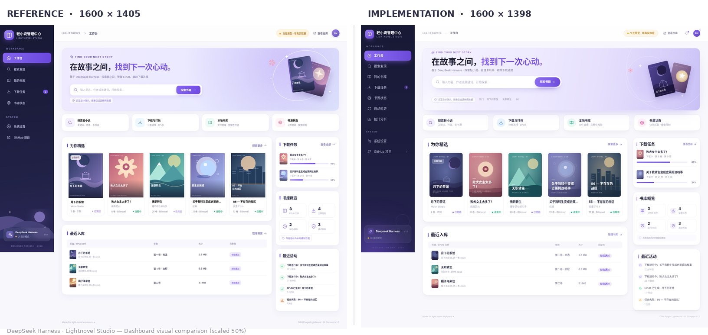

### 4.3 1440×900 与 1920×1080 桌面端

| 1440×900 | 1920×1080 |
| --- | --- |
|  | 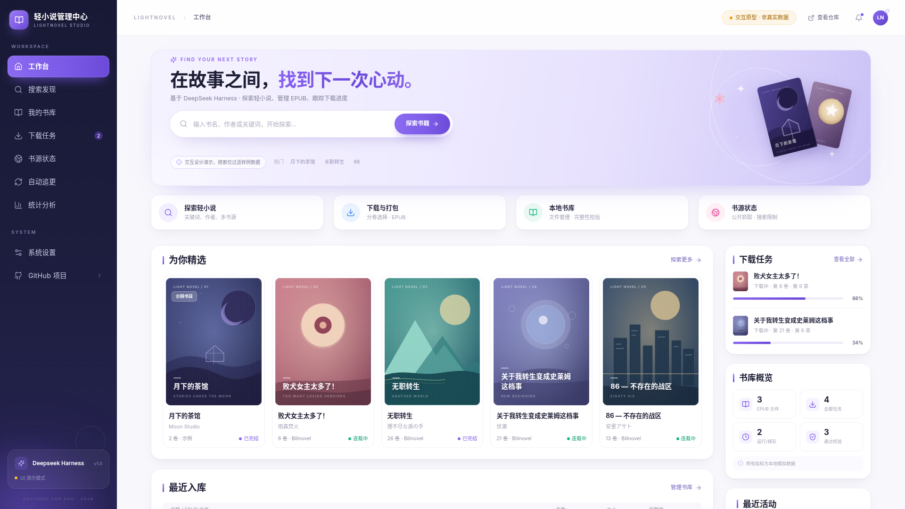 |

### 4.4 其余页面（1600 宽）

| 搜索发现 | 小说详情 |
| --- | --- |
| 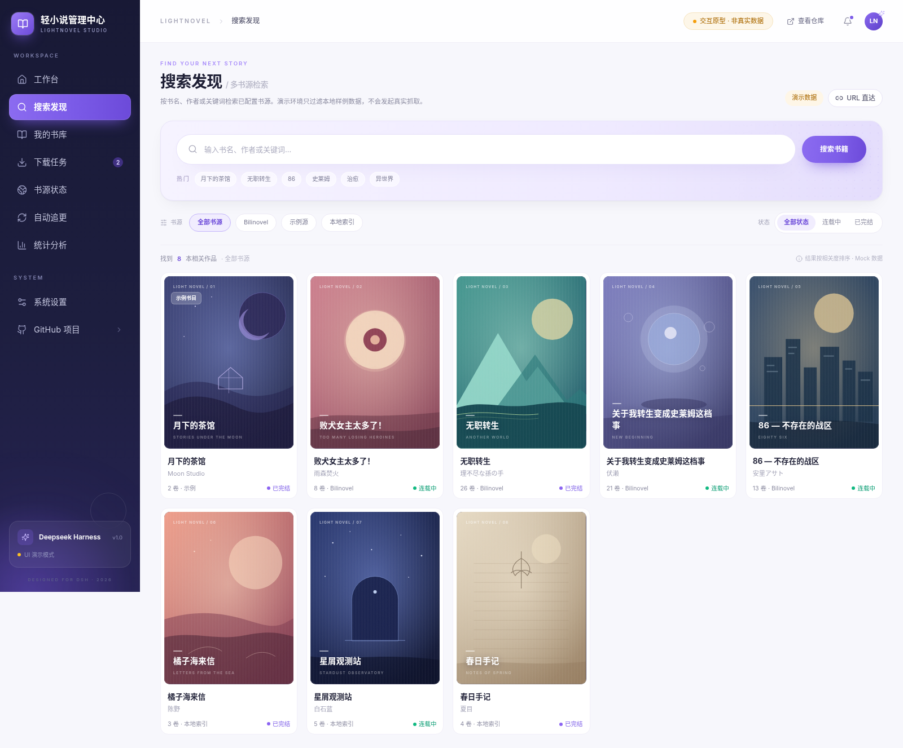 |  |

| 下载任务 | 我的书库（网格） |
| --- | --- |
| 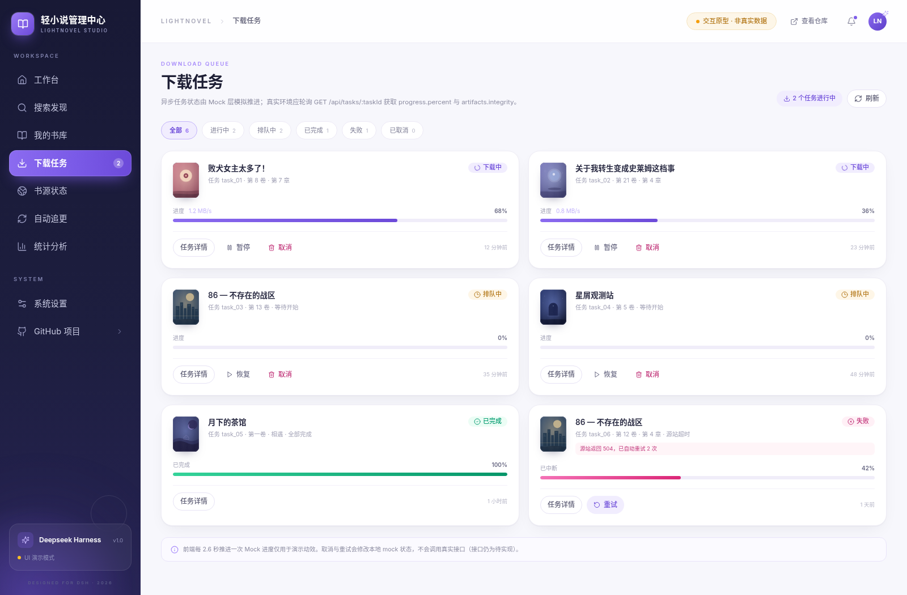 | 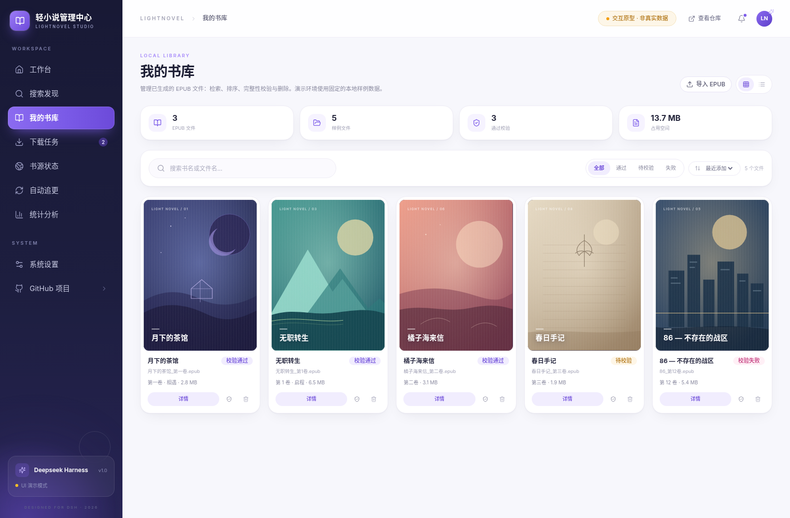 |

| 我的书库（表格） | 书源状态 |
| --- | --- |
| 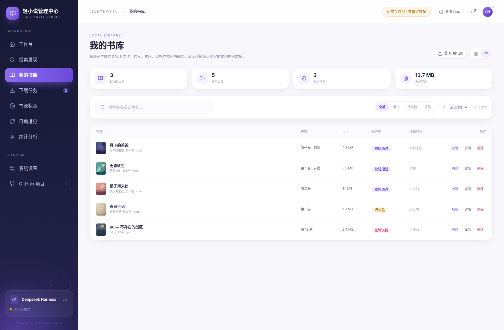 | 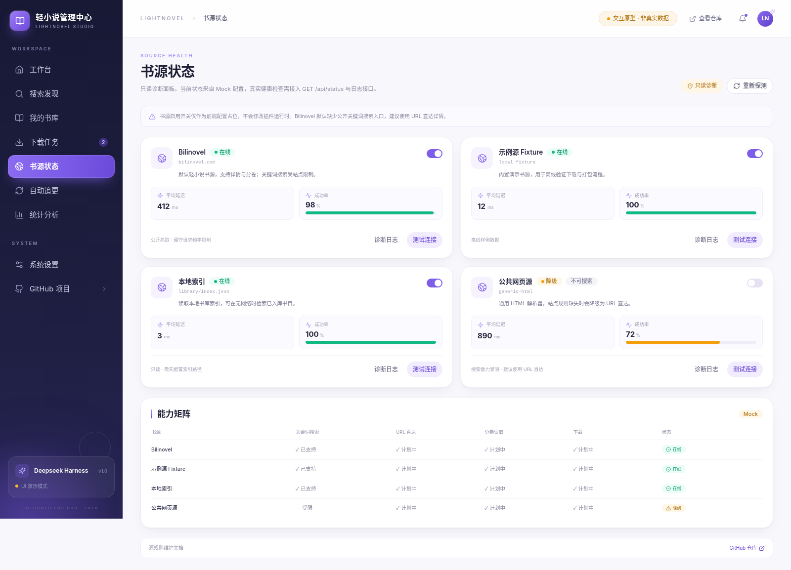 |

| 自动追更（UI 占位） | 统计分析 |
| --- | --- |
| 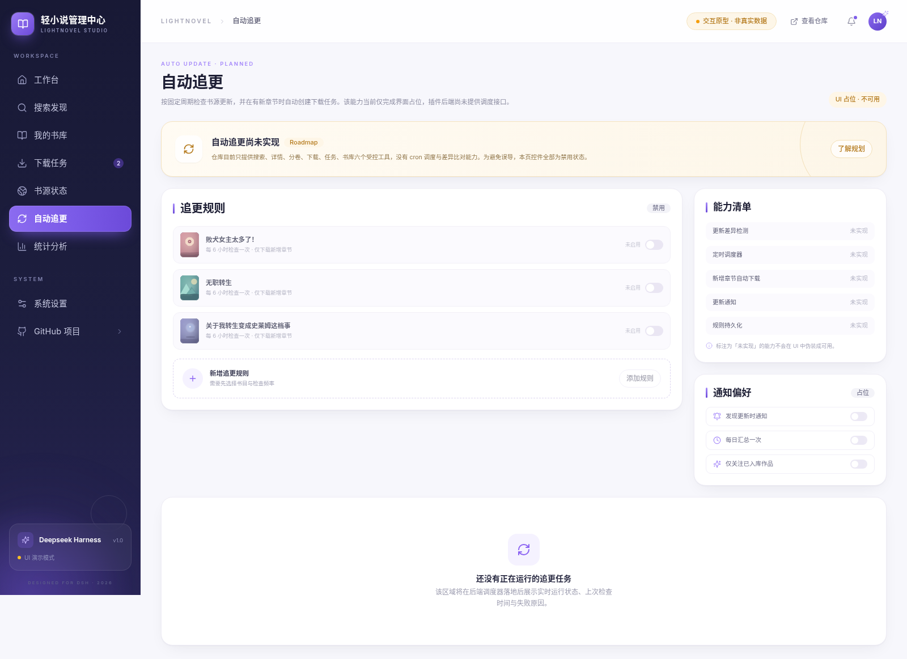 | 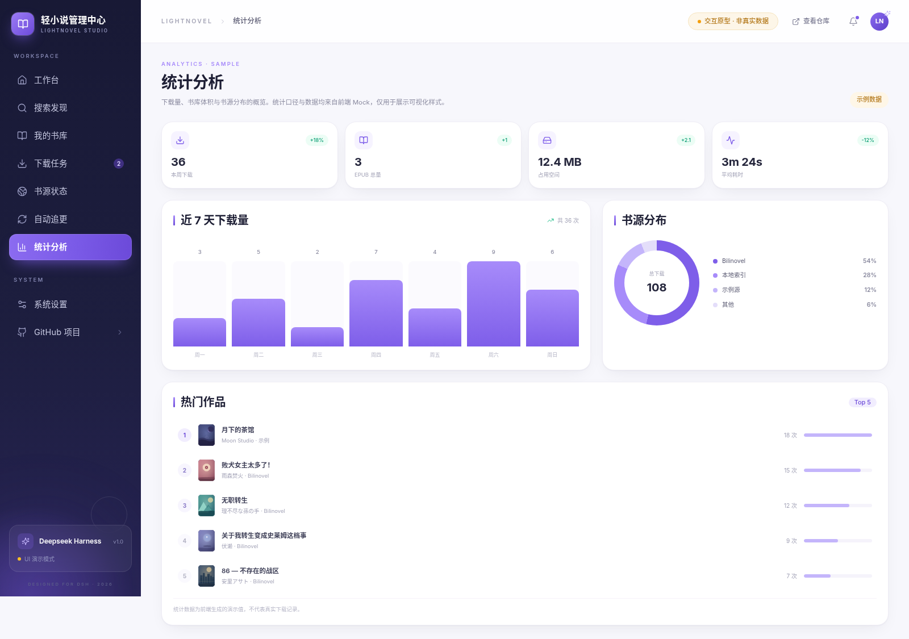 |

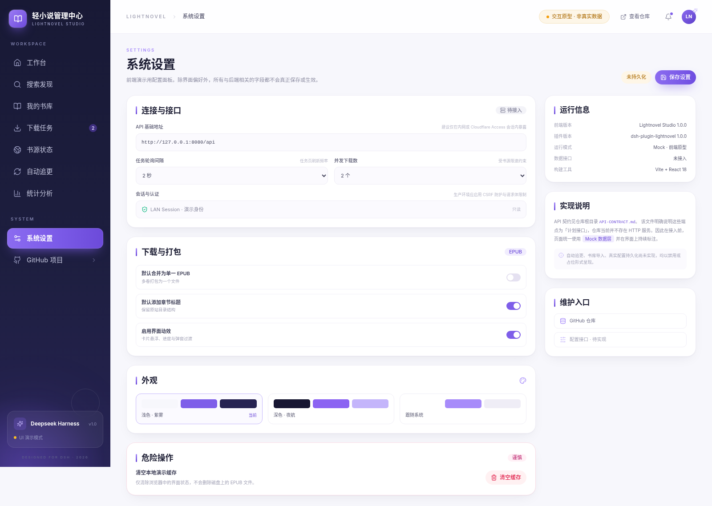

### 4.5 移动端与平板

| 移动端 Dashboard（390） | 移动端搜索 | 移动端任务 |
| --- | --- | --- |
|  | 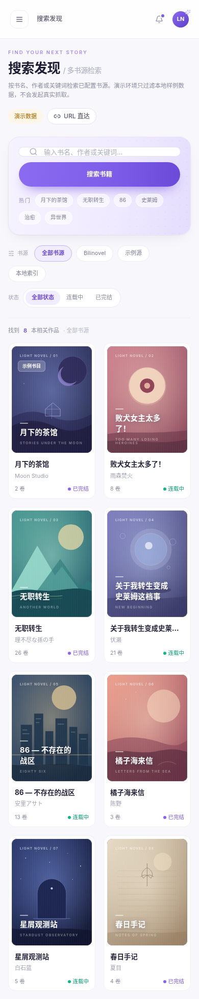 | 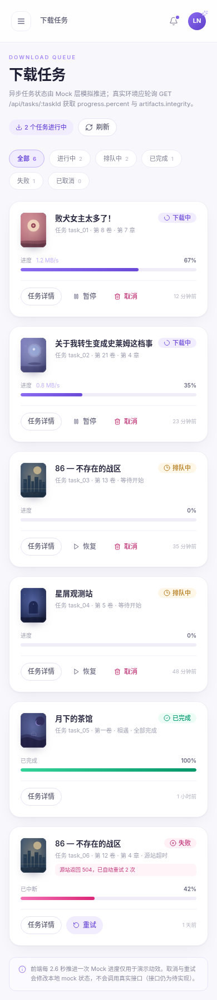 |

| 移动端抽屉导航 | 平板 768 |
| --- | --- |
| 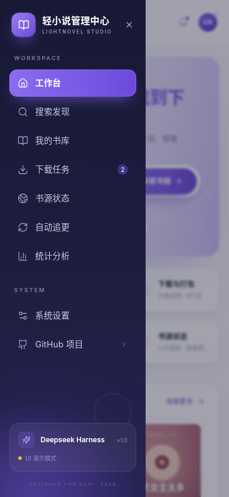 | 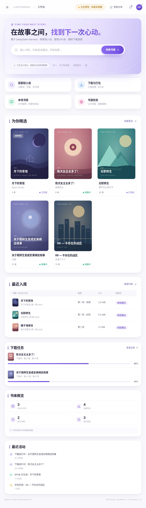 |

---

## 5. 与参考图的还原说明（摘要）

完整逐项说明见 [docs/COMPARISON.md](./docs/COMPARISON.md)。

1. **整体骨架**：248px 深紫侧栏 + 76px 毛玻璃顶栏 + 36px 内边距，顶栏左为 `LIGHTNOVEL > 页面名` 面包屑，右为琥珀色「交互原型 · 非真实数据」胶囊、查看仓库、通知、LN 头像。
2. **Hero 横幅**：淡紫渐变（`#F5F2FF → #C9C1F5`），左侧为 `FIND YOUR NEXT STORY` 小标题、深色主标题 + 紫色渐变副标题、胶囊搜索框、演示提示与热门词；右侧为**原创 SVG 插画**（两本叠放书卡、细线圆环、花瓣与星芒），不使用位图，因此不会出现加载失败或拉伸。
3. **四个功能入口**：等宽 4 列、圆形浅色图标底、标题 + 说明，与参考图的比例/间距一致。
4. **为你精选**：5 列封面卡，封面同为 3:4 比例的抽象几何封面（8 套主题配色，取自参考图取样），卡片含系列号、书名、作者、卷数、书源、连载/完结状态；hover 抬升 + 封面微缩放。
5. **右栏**：下载任务（双任务 + 紫色进度条 + 百分比）、书库概览（2×2 统计块）、最近活动（时间线式 4 条），宽度 310px、卡间距 19px。
6. **最近入库**：表头灰底、三行文件记录、完整性胶囊，列宽按参考图 92 / 74 / 96 对齐。
7. **页脚**：`Made for light-novel explorers ✦` 与 `DSH Plugin LightNovel · UI Concept v1.0` 左右分置。
8. **动效**：卡片 hover 抬升、封面缩放、按钮按压、Toast 右上滑入、页面 `fade-up`、进度条宽度过渡；全部尊重 `prefers-reduced-motion`。

**客观差异（均为需求驱动或环境差异）**

- 需求新增了「自动追更 / 统计分析」两个导航项，参考图只有 7 个入口；导航项间距按比例压缩，未改变视觉语言。
- Hero 内增加「热门」关键词行（搜索页/需求中要求），占用参考图中提示行右侧的空白。
- 所有页面均出现「交互原型 · 非真实数据」标识，这是 Mock 数据的可辨识要求。
- 插画与封面为原创 SVG 重绘，风格贴近参考图而非逐像素复制；书名、作者等文字按参考图布局重新排版。
- 中文字体随操作系统回退（Linux 截图使用 Noto Sans CJK，macOS/Windows 为 PingFang / 微软雅黑），字形宽度略有差异。
- 参考图是 1600×1405 的整页设计稿，侧栏高度为设计视口高度；实现中侧栏为 `fixed` 100vh，长页面滚动时保持可见，整页截图会像参考图一样在首屏底部结束。

---

## 6. 已实现功能

### Dashboard
- 页面导航、搜索提交（跳转搜索页并带上 `q`）、四个入口卡片跳转
- 精选卡点击进入详情；最近入库行跳转书库；右栏「查看全部」跳转任务页
- 下载任务进度实时推进（Mock ticker）、书库概览统计、最近活动、通知下拉

### 小说搜索 `/search`
- 关键词输入 / 回车 / 热门词填入、URL `?q=` 双向同步
- 书源筛选（全部 / Bilinovel / 示例源 / 本地索引）、状态分段筛选
- 420ms 骨架屏加载态、结果计数、降级书源提示、空结果态与重置
- 卡片点击打开详情弹窗（封面 / 标签 / 简介 / 快捷分卷 / 进入完整详情）

### 小说详情 `/novel/:id`
- 渐变 Hero（封面、状态、作者、评分、更新时间、标签、简介）
- 分卷多选 / 全选、已选计数、合并为单一 EPUB、添加章节标题开关
- 「创建下载任务」写入任务队列并提示，跳转下载任务页
- 书源信息与接口说明（标注接口尚未实现）

### 下载任务 `/tasks`
- 6 个状态页签 + 实时计数；任务卡（封面、章节进度、速度、百分比、进度条）
- 暂停 / 恢复 / 取消（二次确认）/ 重试；任务详情弹窗
- 2.6s Mock 推进、Toast 反馈、Mock 声明

### 我的书库 `/library`
- 网格 / 表格双视图切换；搜索、完整性筛选、排序、文件数统计
- 校验文件（Toast）、删除（二次确认）、详情弹窗、导入 EPUB（占位提示）
- 4 个统计块（文件数 / 样例 / 通过校验 / 占用空间）

### 书源状态 `/sources`
- 4 个书源健康卡（延迟、成功率、状态、能力说明）
- 启停开关（仅本地状态）、测试连接（模拟延迟 Toast）、诊断日志弹窗、能力矩阵
- 明确标注「只读诊断 / Mock 配置」

### 统计分析 `/stats`
- 4 个指标卡、近 7 天下载柱状图、书源分布环形图、热门作品 Top 5
- 全部标注「示例数据」

### 自动追更 `/auto-update`
- 顶部黄色「尚未实现 / Roadmap」提示，规则与开关全部禁用
- 能力清单逐项标注「未实现」；空状态说明后端调度器落地后才有数据

### 系统设置 `/settings`
- 接口地址、轮询间隔、并发下载、只读会话信息
- 下载与打包默认项、动效开关、主题占位、清空缓存（确认）
- 所有未持久化项标注「未持久化 / 待接入」

### 通用交互
- Toast 通知（右上堆叠、4.2s 自动消失、可关闭）
- Modal（遮罩点击 / ESC 关闭 / 滚动锁定）
- 响应式：≥1280 两栏、768–1279 单栏重排、<768 抽屉导航 + 2 列封面 + 表格卡片化
- 键盘可达：导航、卡片（Enter/Space）、弹窗 ESC

---

## 7. Mock 功能清单（与真实能力的边界）

> 计划接口见仓库根目录 `API-CONTRACT.md`；其中明确「仓库尚未实现 HTTP API」。因此前端所有数据访问集中在 `novelApi`，默认 `API_MODE = 'mock'`。

| 功能 | 当前实现 | 真实接口（待实现） |
| --- | --- | --- |
| 小说搜索 | 本地 8 本样例按关键词/书源/状态过滤，420ms 模拟延迟 | `GET /api/novels?query=&sources=&status=` |
| 小说详情 | Mock 小说字段 | `GET /api/novels/:id` |
| 分卷 / 章节 | Mock 8 卷 × 8 章 | `GET /api/novels/:id/volumes` |
| 创建下载 | 写入前端 `taskStore`，Toast + 跳转 | `POST /api/tasks` |
| 任务列表 | 6 条 Mock 任务，2.6s 推进 running 任务 | `GET /api/tasks?state=` / `GET /api/tasks/:id` |
| 暂停 / 恢复 | 本地状态机（页面刷新即重置） | 需后端补充接口 |
| 取消 / 重试 | 本地状态机 + 二次确认 | `POST /api/tasks/:id/cancel` / `retry` |
| EPUB 书库 | 5 条本地样例、统计 3/5/3/13.7MB | `GET /api/library?query=` / `GET /api/library/stats` |
| 校验文件 | 仅 Toast 动画，无真实校验 | `POST /api/library/:id/verify` |
| 删除文件 | 本地列表移除 + 确认弹窗 | `DELETE /api/library/:id`（需 `confirm: true`） |
| 导入 EPUB | 占位提示，未接文件选择 | 需后端上传接口 |
| 书源健康 | 4 条 Mock 指标；开关仅改本地 UI | `GET /api/status` + `GET /api/logs` |
| 连接测试 | 600ms 模拟延迟 Toast | 后端探测接口 |
| 自动追更 | 完整占位，全部禁用并标注「未实现」 | 需 cron 调度与差异对比能力 |
| 统计图表 | 示例数据（36 次 / 108 次 / Top5） | 需统计接口 |
| 设置持久化 | 仅组件内存，标注「未持久化」 | 需配置读写接口 |
| 主题切换 | 占位（仅展示配色卡） | 后续实现 |

**Mock 可辨识措施**：顶栏常驻「交互原型 · 非真实数据」；页面级 `演示数据 / Mock / 示例数据` 标签；搜索页、任务页、书库页、统计页、设置页底部均有说明文案；`mock.ts` 每条数据带 `isMock: true`。

---

## 8. 接入真实 API

1. 在 `src/services/novelApi.ts` 把 `API_MODE` 改为 `'live'`，按文件顶部注释实现各方法（签名已与页面解耦，页面无需改动）。
2. 在 `vite.config.ts` 打开已预留的 `/api` 代理：

```ts
server: { proxy: { '/api': { target: 'http://127.0.0.1:8000', changeOrigin: true } } }
```

3. 任务轮询：真实模式下用 `GET /api/tasks/:id` 的 `progress.percent`、`chaptersDone`、`currentChapter`、`artifacts[].integrity` 替换 `taskStore` 的 ticker（当前 ticker 仅演示动效）。
4. 删除文件必须带 `confirm: true` 并由后端二次校验，前端弹窗仅是第一道确认。

---

## 9. 验证记录

| 项目 | 结果 |
| --- | --- |
| `npm run typecheck` | 通过（无 TS 报错） |
| `npm run build` | 通过（Vite 生产构建，JS ≈ 337KB / gzip ≈ 100KB，CSS ≈ 58KB） |
| Playwright 全站巡检 | 9 个路由 + 移动端抽屉，无 console error / pageerror |
| 视觉基准 | 1600×1050 视口整页 1398px，与参考图 1405px 高度基本一致；关键区块坐标见 COMPARISON.md |
| 交互回归 | 导航切换、搜索提交与空态、书源筛选、详情弹窗开关、全选分卷、创建任务、暂停/恢复、取消确认、任务详情、书库视图切换/筛选、通知下拉、移动端抽屉跳转 均通过 |
| 响应式 | 1440×900、1920×1080、768×1024、390×844 均无横向溢出；表格在 <640px 隐藏表头并改为两行卡片式 |

---

## 10. 已知限制

- 无真实后端：刷新页面后任务、书库、设置等演示状态会重置。
- 自动追更、导入 EPUB、主题切换、书源启停持久化为明确的 UI 占位，**未伪造成可用功能**。
- 插画与封面为原创 SVG；若需与设计稿逐像素一致的位图素材，可在 `public/images/` 放置授权素材并替换 `CoverArt` 内的 SVG。
- 中文排版依赖系统字体，不同平台字宽会有轻微差异。

---

## 11. 素材与许可

- 界面插画、8 套小说封面、favicon 均为本项目原创 SVG，无第三方版权素材。
- 字体：Inter（SIL Open Font License），已本地化到 `public/fonts/`。
- 图标：Lucide（ISC License）。
